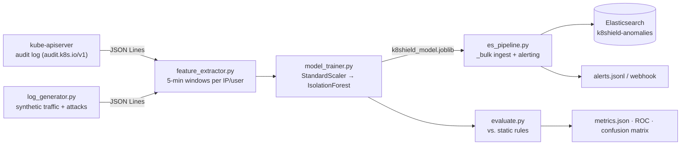
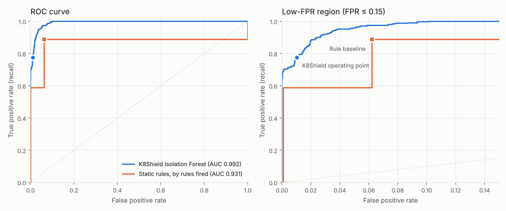
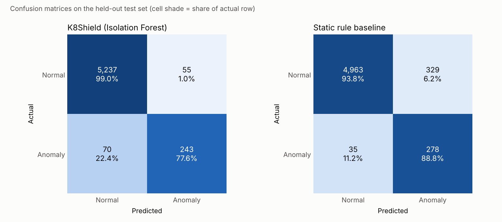

<div align="center">

<div align="center">
  
</div>

<br/>

[](https://k8shield.netlify.app/)
[](https://www.irjet.net)
[](https://python.org)
[](https://scikit-learn.org)

<br/>

**Real-time Kubernetes anomaly detection with Isolation Forests and Elasticsearch.**

</div>

K8Shield turns raw Kubernetes API-server audit logs into behavioural features, one row per (source IP, user) per 5-minute window. It scores each window with an unsupervised Isolation Forest and streams the results into Elasticsearch for alerting. This repository contains the full pipeline: a synthetic audit-log generator with labelled attack injection, feature extraction, model training, Elasticsearch ingestion, a benchmark against a static rule baseline, and the project page served at [k8shield.netlify.app](https://k8shield.netlify.app/).

```bash
cd backend
pip install -r requirements.txt
python main.py run
```

On a laptop, that one command finishes in about 15 seconds. It generates two days of labelled audit logs, trains on day one, evaluates on day two, writes plots and metrics to `backend/reports/`, and indexes the scored windows into a local mock Elasticsearch index.

---

## Architecture



| Module | Responsibility |
|---|---|
| `log_generator.py` | Generates realistic `audit.k8s.io/v1` events from kubelets, controllers, health probes, service accounts, CI/CD, and humans. Injects three attack types at a configurable rate. |
| `feature_extractor.py` | Parses audit JSON (JSON Lines or `EventList`) and aggregates tumbling or sliding windows into a clean `pandas.DataFrame`. |
| `model_trainer.py` | `Pipeline(StandardScaler, IsolationForest)`. Produces anomaly scores and `1`/`-1` predictions, and saves `k8shield_model.joblib` and `k8shield_scaler.joblib`. |
| `es_pipeline.py` | Streams scored windows to Elasticsearch through the REST `_bulk` API (standard library only, with retries) or to a file-backed mock index. Raises alerts. |
| `evaluate.py` | Benchmarks against a static rule baseline: Precision, Recall, F1, FPR, ROC AUC, matched-recall FPR, and per-attack recall. Also draws the plots. |
| `main.py` | CLI orchestration (`generate`, `train`, `evaluate`, `ingest`, `run`). |

## Data and threat model

**Normal traffic** comes from about 30 identities. Six kubelets send heartbeats. Load-balancer probes hit `/readyz` and `/livez`. The controller manager and scheduler run as usual, as do cert-manager (reading secrets cluster-wide), Prometheus (listing pods in every namespace), CoreDNS, Argo CD (with occasional sync bursts), application service accounts reading their own secrets, a GitLab runner doing Helm deploy bursts, a GitHub Actions deployer calling from public cloud IPs, a platform admin who edits RoleBindings, and developers who exec into dev pods.

The generator also includes **rare but legitimate** behaviour, because it causes most false positives in real clusters:

* an on-call SRE who execs into production from a home IP;
* a workload that retries with a revoked token (a storm of 401s);
* hourly Velero backups that list secrets in every namespace;
* a new contractor who keeps hitting 403s.

**Injected attacks**, labelled through the `k8shield.io/injected-anomaly` annotation, which is never used as a feature:

| Type | Behaviour |
|---|---|
| `rbac_escalation` | Runs `SelfSubjectRulesReview` reconnaissance, enumerates ClusterRoles and ClusterRoleBindings, then tries to create ClusterRoleBindings to `cluster-admin`. |
| `exec_anomaly` | Runs `pods/exec` into `production`, `payments`, or `checkout` pods from unfamiliar external IPs (or a compromised pod), and reads secrets. |
| `secret_burst` | Sends 60–600 GET/LIST requests in under 3 minutes to `/api/v1/namespaces/kube-system/secrets`. |

By default, 30% of attacks are **stealthy** (`--stealth-ratio`): they use the cluster's common kubectl build, come from inside the pod network, keep volume low, and avoid authorization failures. Without this, every detector scores close to 100% and the benchmark tells you nothing.

`--anomaly-ratio` (default `0.05`) sets the share of anomalous **entity windows**, which is the unit detection runs on. A single secret burst can produce hundreds of events, so the share of anomalous *events* is much higher (about 25%). Both figures are printed in the generation stats.

## Features

| Feature | Definition |
|---|---|
| `request_count` | API requests in the window |
| `verb_entropy` | Shannon entropy (bits) of HTTP methods (GET/POST/PUT/PATCH/DELETE), mapped from audit verbs |
| `rbac_escalation_flag` | 1 if the window contains a write to a (Cluster)Role or (Cluster)RoleBinding, or anything that references `cluster-admin` |
| `unique_namespaces_accessed` | Distinct namespaces targeted |
| `unusual_user_agent_score` | `log(1/p) / log(N)` rarity of the client, where `p` is the share of training entity windows that used it. Unseen clients score 1.0 |
| `error_code_rate` | Share of 401/403 responses |
| `exec_ratio`\* | Share of `pods/exec`, `attach`, or `portforward` requests |
| `secret_access_ratio`\* | Share of requests that touch `secrets` |
| `external_source_flag`\* | 1 if the source IP is not RFC 1918, loopback, or link-local |

\* Extended context features. Pass `--core-only` to train on the six core features alone.

The user-agent frequency table is the extractor's only learned state. It is fitted on training data only and saved inside the model bundle, so scoring new logs uses exactly the same feature definitions.

## Benchmark results

These are the default settings: one simulated day for training and another day for testing, 5% anomalous entity windows, 30% stealthy attacks, `contamination=0.05`, and 300 trees. Run with `python main.py run --runs 5`.

**Run 1** (train seed 42, test seed 43). There are 5,605 test windows, 5.58% of them anomalous.

| Detector | Precision | Recall | F1 | FPR | ROC AUC | False positives |
|---|---:|---:|---:|---:|---:|---:|
| Static rule baseline | 0.458 | 0.888 | 0.604 | 0.0622 | 0.931 | 329 |
| **K8Shield (Isolation Forest)** | **0.815** | 0.776 | **0.795** | **0.0104** | **0.992** | **55** |

**Mean ± std over 5 independent seed pairs:**

| Metric | Static rules | K8Shield |
|---|---:|---:|
| Precision | 0.432 ± 0.021 | 0.779 ± 0.049 |
| Recall | 0.911 ± 0.017 | 0.771 ± 0.019 |
| F1 | 0.585 ± 0.018 | 0.774 ± 0.021 |
| FPR | 0.0657 ± 0.0025 | 0.0121 ± 0.0035 |
| ROC AUC | — | 0.990 ± 0.002 |
| **FPR reduction, default operating points** | | **81.6% ± 5.2%** |
| **FPR reduction at matched recall** | | **38.5% ± 25.2%** (range 8%–63%) |

<p align="center">
  <br>
  
</p>

### How to read these numbers

* **The two FPR-reduction figures answer different questions.** At default operating points, the Isolation Forest flags about 5% of windows (set by `contamination`), so it trades recall (0.77 vs 0.91) for far fewer false positives. The **matched-recall** figure sets the forest's threshold so it reaches the rules' recall exactly, which removes that trade-off. It is the fairer number to cite when making a "fewer false alarms at the same detection rate" claim, and it varies a lot from seed to seed.
* **The rules win on some attack types.** They catch 100% of `rbac_escalation` and `exec_anomaly` windows because they fire on *any* RBAC write or exec. That is also why they flag every admin RoleBinding and every developer shell. The forest catches about 66% of exec anomalies: stealthy exec from inside the pod network with the common kubectl client looks a lot like a developer session. The per-type breakdown is in [`backend/reports/benchmark_report.md`](backend/reports/benchmark_report.md).
* **Results are synthetic.** The absolute numbers depend on the generator's parameters (attack mix, stealth ratio, how noisy the benign traffic is). They show how the method behaves under a controlled, documented threat model. They are not a measurement of production performance. Validate on real audit logs before you make operational claims.

## Usage

### Setup

```bash
git clone https://github.com/CosmicMicra/k8shield.git
cd k8shield/backend
python -m venv .venv && source .venv/bin/activate   # Python 3.10+
pip install -r requirements.txt                     # scikit-learn, pandas, numpy, matplotlib, joblib
```

All commands below run from the `backend/` folder.

### Full pipeline

```bash
python main.py run                          # one train/test seed pair
python main.py run --runs 5                 # adds mean ± std across 5 seed pairs (reports/summary.json)
python main.py run --anomaly-ratio 0.02 --stealth-ratio 0.5 --contamination auto
python main.py run --window 5 --stride 1    # 5-minute sliding windows, 1-minute stride
python main.py run --core-only              # only the six core features
```

### Individual stages

```bash
# 1. Generate 12 hours of logs with a 3% anomaly rate
python main.py generate --minutes 720 --anomaly-ratio 0.03 --seed 7 -o data/raw/audit.jsonl

# 2. Train (writes models/k8shield_model.joblib and models/k8shield_scaler.joblib)
python main.py train data/raw/audit.jsonl --contamination 0.05

# 3. Evaluate on a different labelled log
python main.py generate --seed 8 -o data/raw/holdout.jsonl
python main.py evaluate data/raw/holdout.jsonl --out-dir reports/

# 4. Score and stream to the mock index (data/es_mock/) ...
python main.py ingest data/raw/holdout.jsonl
# ... or to a real cluster
python main.py ingest data/raw/holdout.jsonl --es-url https://es.example.com:9200 --es-api-key "$ES_API_KEY"
```

Each module also runs on its own: `python log_generator.py -h`, `python feature_extractor.py -h`, and so on.

### Scoring real cluster logs

Enable an [audit policy](https://kubernetes.io/docs/tasks/debug/debug-cluster/audit/) with at least `Metadata` level, plus `Request` level for RBAC resources if you want `roleRef` inspection. The log backend writes JSON Lines in exactly the format K8Shield reads:

```python
from feature_extractor import load_events
from model_trainer import K8ShieldModel

model = K8ShieldModel.load("models/")
features = model.extractor.transform(load_events("/var/log/kubernetes/audit.log"))
scored = model.score(features)            # adds anomaly_score, prediction (1/-1), is_flagged
print(scored.nlargest(10, "anomaly_score")[["window_start", "source_ip", "user", "anomaly_score"]])
```

On a real cluster, retrain on a period you believe is clean (or mostly clean), and set `contamination` to your alert budget.

### Elasticsearch

`docker-compose.yml` starts a local single-node Elasticsearch and Kibana with security disabled (for development only):

```bash
docker compose up -d
python main.py ingest data/raw/test_audit_seed43.jsonl --es-url http://localhost:9200
```

Documents land in the `k8shield-anomalies` index with an explicit mapping (`@timestamp: date`, `source_ip: ip`, `anomaly_score: float`, `is_flagged: boolean`, …):

```json
{
  "@timestamp": "2026-01-06T13:05:00+00:00",
  "window_end": "2026-01-06T13:10:00+00:00",
  "source_ip": "185.220.101.23",
  "user": "system:serviceaccount:default:default",
  "anomaly_score": 0.712,
  "is_flagged": true,
  "severity": "critical",
  "features": {"request_count": 412.0, "error_code_rate": 0.61, "...": "..."},
  "model_version": "1.0.0",
  "event": {"kind": "alert", "module": "k8shield"}
}
```

If the Elasticsearch URL is unreachable, the pipeline logs a warning and falls back to the mock index instead of failing. Flagged documents go to `data/es_mock/alerts.jsonl` and, optionally, to a Slack-compatible webhook (`--webhook-url`).

## Model details

* **Scaling:** `StandardScaler` fitted on training windows.
* **Detector:** `IsolationForest(n_estimators=300, contamination=0.05, max_samples="auto")`. Training is unsupervised, and ground-truth labels are never passed to `fit`.
* **Anomaly score:** `-score_samples(x)`, the `s(x, n)` score of Liu et al. (2008), in (0, 1]. Values near 1 are clear outliers. The flagging threshold (about 0.59 with the defaults) is stored in the bundle metadata.
* **Bundle:** `k8shield_model.joblib` holds the pipeline, the feature names, the extractor state (the UA table and window config), the hyper-parameters, the scikit-learn version, and training statistics. `k8shield_scaler.joblib` holds the fitted scaler alone. Loading warns if the scikit-learn version differs from the one used for training.

**Static rule baseline** (`evaluate.RuleBasedDetector`). A window is flagged if any rule fires: `request_count > 100`, `error_code_rate >= 0.20`, any RBAC write, any `pods/exec`, or `unique_namespaces_accessed > 10`. The thresholds live in `RuleThresholds` and are easy to change.

## Project layout

```
k8shield/
├── backend/
│   ├── log_generator.py        # synthetic audit.k8s.io/v1 events + attack injection
│   ├── feature_extractor.py    # windowed behavioural features
│   ├── model_trainer.py        # StandardScaler + IsolationForest, persistence
│   ├── es_pipeline.py          # Elasticsearch _bulk / mock index + alerting
│   ├── evaluate.py             # benchmark vs. static rules, plots
│   ├── main.py                 # CLI
│   ├── tests/test_pipeline.py  # pytest suite (~8 s)
│   ├── reports/                # committed benchmark output (metrics, plots)
│   ├── docker-compose.yml      # optional Elasticsearch + Kibana
│   ├── requirements.txt
│   └── requirements-dev.txt
├── site/index.html             # static project page (k8shield.netlify.app)
└── netlify.toml                # Netlify: publish site/, no build step
```

`backend/data/` and `backend/models/` are generated and git-ignored. Everything is reproducible from seeds.

## Development

```bash
cd backend
pip install -r requirements-dev.txt
pytest -q
```

## Limitations and future work

* The data is synthetic. Replaying public or real audit datasets is the main next step.
* Entities are (IP, user) pairs. An attacker who reuses a known identity *and* its usual IP is only detectable through behaviour within the window.
* The Isolation Forest is a point-in-time detector. Per-entity baselines, sequence models, or a hybrid with high-precision rules (for example, any `cluster-admin` binding) would close the exec-anomaly recall gap.
* Elasticsearch ingestion is batch replay of scored windows. For live clusters, run the extractor and scorer on a rolling buffer fed by a webhook audit backend or Fluent Bit.

## 📄 Publication

**K8Shield: Real-Time Kubernetes Security Monitoring using Machine Learning**
*Soniya Phaltane (First Author) · IRJET Volume 11, Issue 9 · 2024*

This repository is a rebuilt, reproducible implementation of the pipeline.

## 👩‍💻 Author

**Soniya Phaltane** · [@CosmicMicra](https://github.com/CosmicMicra)
ML Engineer · AI Security · [soniyaphaltane-portfolio.netlify.app](https://soniyaphaltane-portfolio.netlify.app)
